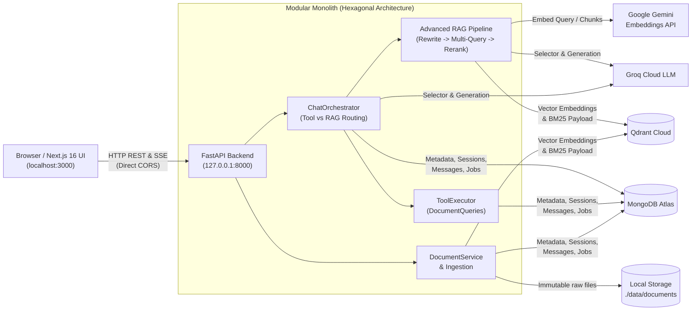

# RAG Workspace

**RAG Workspace** is a full-stack Retrieval-Augmented Generation (RAG) document Q&A platform built with **FastAPI**, **Next.js 16**, **LangChain**, **Groq LLM**, **Google Gemini Embeddings**, **MongoDB Atlas**, and **Qdrant Cloud**.

The project is currently a **Functional Single-user RAG MVP** featuring immutable document lifecycle management, persistent multi-turn sessions, verified citations, typed Server-Sent Events (SSE) streaming, **Advanced RAG** capabilities (Hybrid Search, Cross-Encoder Reranking, Parent-Child Chunking, Multi-Query Expansion), and **Tool Use**. *(Authentication/RBAC and multi-tenancy are deferred for this MVP phase).*

---

## 1. Key Features

- **Document Lifecycle Management**: Upload PDF, TXT, Markdown, and XLSX files; track ingestion status (`PENDING` $\rightarrow$ `PROCESSING` $\rightarrow$ `INDEXED`); manage immutable versions, re-indexing, safe deletion, and preview document contents (Text/Excel preview).
- **Advanced RAG Pipeline**:
  - **History-aware Query Rewriting**: Resolves conversational references using recent whole turns.
  - **Multi-Query Expansion**: Generates multiple search perspectives to broaden retrieval recall.
  - **Hybrid Search**: Combines semantic similarity (Dense Vector) and keyword matching (BM25/Text Match) on Qdrant via **Reciprocal Rank Fusion (RRF)**.
  - **Parent-Child Chunking**: Indexes small child chunks for high-precision retrieval while supplying full parent chunks to the LLM for coherent context.
  - **Post-retrieval Reranking**: Re-scores candidate chunks using a local Cross-Encoder (**FlashRank ONNX**) or **Cohere**.
- **Intelligent Tool Use**: Integrates Groq Function Calling (`count_documents`, `list_documents`) to automatically route library inventory queries directly to MongoDB instead of vector retrieval.
- **Modern Chat Experience**: Real-time SSE token streaming, rich Markdown/GFM/Code rendering, and interactive `[n]` citation badges linked to source metadata.

---

## 2. Technology Stack

| Layer | Technologies |
| :--- | :--- |
| **Backend API** | Python 3.12 (3.10+ compatible), FastAPI, Uvicorn, Pydantic Settings |
| **Frontend UI** | Node.js 20+, Next.js 16.4 (App Router), React 19.3, Tailwind CSS v4, Base UI |
| **LLM & Tool Calling** | Groq API (`openai/gpt-oss-120b` via `langchain-openai`) |
| **Embeddings** | Google Gemini Embedding (`gemini-embedding-001` via `langchain-google-genai`) |
| **Reranker** | FlashRank (local ONNX) / Cohere |
| **Vector Database** | Qdrant Cloud |
| **Metadata & History DB** | MongoDB Atlas |
| **Raw File Storage** | Local Filesystem (`./data/documents`) |

---

## 3. System Architecture



---

## 4. Repository Structure

```text
rag-demo/
├── backend/                     # FastAPI Modular Monolith (See backend/README.md)
│   ├── app/                     # Source code: api, chat, conversations, documents, rag, tool_use, infrastructure
│   ├── evaluation/              # Offline/online RAG evaluation datasets & scoring runner
│   ├── scripts/                 # Cloud connection checks, index initialization & migration scripts
│   ├── tests/                   # AST architecture, unit, integration, and smoke test suites
│   └── requirements.txt         # Python dependencies
├── frontend/                    # Next.js 16 App Router UI (See frontend/README.md)
│   ├── app/                     # Routes: /chat, /chat/[sessionId], /documents
│   ├── components/              # Chat, Document Management, and AppShell UI components
│   ├── lib/                     # API clients, SSE parser, state controllers
│   ├── tests/ & e2e/            # Node unit/contract tests and Playwright E2E specs
│   └── package.json             # Frontend dependencies & npm scripts
├── data/                        # Raw file storage directory and sample prompt/corpus fixtures
├── docs/                        # Architecture decisions (ADRs), audit reports, and QA runbooks
├── .env.example                 # Backend environment variable template
└── README.md                    # Project overview and quickstart guide (this file)
```

---

## 5. Getting Started

### 5.1 Prerequisites
- **Python**: 3.12 (recommended, verified on CI) or `>= 3.10`.
- **Node.js**: `>= 20.9` (Node.js 20 verified on CI).
- **Required Cloud Services**:
  1. **MongoDB Atlas** cluster (read/write connection URI).
  2. **Qdrant Cloud** cluster (HTTPS URL and API Key).
  3. **Groq API Key** ([console.groq.com](https://console.groq.com)).
  4. **Google AI Studio API Key** for Gemini Embeddings ([aistudio.google.com](https://aistudio.google.com/apikey)).

### 5.2 Backend Setup & Startup
Open **Terminal 1** at the repository root (`rag-demo/`):

```powershell
# 1. Create and activate Python virtual environment
python -m venv .venv
.\.venv\Scripts\Activate.ps1

# 2. Install Backend dependencies
pip install -r backend/requirements.txt

# 3. Create .env from template and populate API keys / Database URIs
if (!(Test-Path .env)) { Copy-Item .env.example .env }

# 4. Verify MongoDB & Qdrant connectivity (optional)
python backend/scripts/check_cloud_connections.py

# 5. Start FastAPI development server on port 8000
python -m uvicorn app.main:app --app-dir backend --reload --port 8000
```

Verify the Backend is running:
- Dependency health check: `http://127.0.0.1:8000/health/dependencies` (returns HTTP `200` when MongoDB and Qdrant are ready).
- Interactive Swagger UI: `http://127.0.0.1:8000/docs`.

### 5.3 Frontend Setup & Startup
Open **Terminal 2** at the repository root and navigate to `frontend/`:

```powershell
# 1. Navigate to frontend directory
Set-Location frontend

# 2. Install dependencies
npm.cmd ci

# 3. Create browser environment configuration
if (!(Test-Path .env.local)) { Copy-Item .env.example .env.local }

# 4. Start Next.js development server on port 3000
npm.cmd run dev -- --hostname 127.0.0.1 --port 3000
```

> *(Tip)* To explore the UI **without configuring cloud services or API keys**, run the provider-free Mock Server as documented in [`frontend/README.md`](frontend/README.md#52-provider-free-demo-mock-mode).

### 5.4 Accessing the Application
Open your browser and navigate to **`http://127.0.0.1:3000`** (or `http://localhost:3000`):
- Upload and manage documents under **Documents** (`/documents`).
- Ask knowledge questions or query document inventory under **Chat** (`/chat`).

---

## 6. Testing

All test suites below run **completely offline** without making live Groq or Gemini API calls:

| Scope | Command | Coverage |
| :--- | :--- | :--- |
| **Backend Architecture** | `cd backend; python -m unittest discover -s tests/architecture -v` | AST static dependency invariants (Hexagonal) |
| **Backend Unit & Integration** | `cd backend; python -m unittest discover -s tests/unit -v` | 251 unit tests (RAG, Hybrid, Rerank, Tools) |
| **Frontend Lint & Types** | `cd frontend; npm.cmd run lint; npm.cmd run typecheck` | ESLint & TypeScript strict compilation |
| **Frontend Unit & Contract** | `cd frontend; npm.cmd test; npm.cmd run test:contract` | 210 Node tests & Backend API contract parity |
| **Frontend E2E (Playwright)** | `cd frontend; npm.cmd run build:e2e; npm.cmd run test:e2e` | Chromium browser scenarios against mock API |

---

## 7. Detailed Documentation

- **[Backend README](backend/README.md)**: Modular Monolith architecture, ingestion pipeline, Advanced RAG, Tool Use, API endpoints, and `.env` reference.
- **[Frontend README](frontend/README.md)**: Next.js App Router architecture, UI components, SSE streaming parser, mock mode, and QA workflows.
- **[Documentation Index (`docs/README.md`)](docs/README.md)**: Architecture Decision Records (ADRs), codebase audits, refactoring logs, and QA runbooks.
