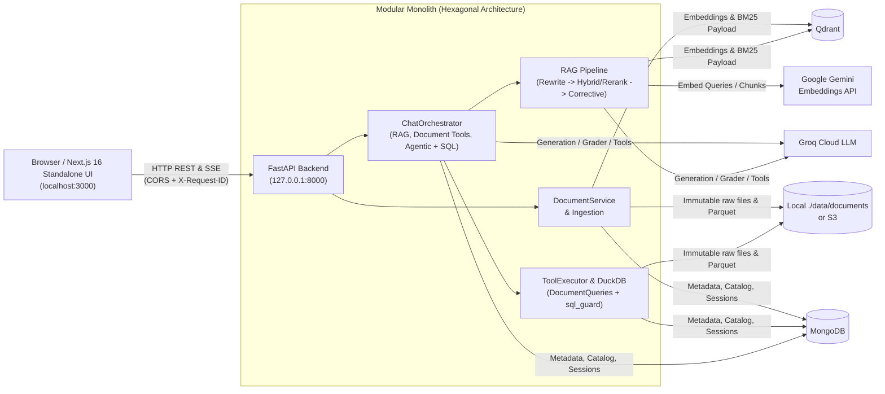

# RAG Workspace

RAG Workspace is a document question-answering platform paired with an isolated HR Demo Portal. It runs on FastAPI, Next.js 16 (App Router, `output: "standalone"`), LangChain, Groq LLM (`openai/gpt-oss-120b`), Google Gemini Embeddings (`gemini-embedding-001`), MongoDB, Qdrant, and local or S3-compatible object storage.

---

## Implementation status

The table below separates capabilities by their current verification state in the codebase.

| Status | Area | Current state and scope |
| :--- | :--- | :--- |
| **Verified** | Core RAG and document lifecycle | Immutable versioning (`UPLOADED` -> `PROCESSING` -> `INDEXED` -> `DELETED`), upload limits (`25 MiB` general, `10 MiB` `.xlsx` returning HTTP `413 Content Too Large`), safe `.xlsx` parsing, TXT/MD/XLSX preview, hybrid search (Dense + BM25 RRF), FlashRank/Cohere reranking, history-aware query rewriting, and token context budgeting. |
| **Verified** | Chat transport and sessions | `POST /chat` (JSON), `POST /chat/stream` (typed SSE frames: `start`, `metadata`, `citation`, `delta`, `done`, `error`), per-session concurrency guard (`409 Conflict`), up to 20 message attachments, and session retrieval scope (`ALL_ACTIVE` and `SELECTED_DOCUMENTS`). |
| **Verified** | Agentic mode and Excel DuckDB SQL | `ChatOrchestrator` iterative tool loop (`count_documents`, `list_documents`, `rag_search`, `run_sql`) with `sqlglot` AST validation and read-only DuckDB execution over Parquet tables (`STORAGE_BACKEND=local`). |
| **Verified** | Corrective RAG | Lightweight retrieval relevance grading (`CORRECTIVE_GRADER_MODEL`), single query-correction retry, and safe fallback when retrieved evidence is insufficient. |
| **Verified** | Observability | Structured JSON logging (`LOG_FORMAT=json`), validated `X-Request-ID` propagation, secret redaction in logs and traces, Prometheus metrics on `GET /metrics` (`METRICS_ENABLED=true`), and Langfuse v2 tracing with payload content redaction by default (`LANGFUSE_TRACE_CONTENT_ENABLED=false`). |
| **Verified** | HR Demo Portal | Isolated routes under `/hr`, `/hr/documents`, and `/hr/guide` with `HrChatbotWidget` (`surface="hr"`) alongside static workforce demo fixtures (`HR_ANALYTICS_FIXTURE`) and live `GET /documents` knowledge-base counts. |
| **Tested (Offline/Isolated)** | External storage, queues, rate limits, and eval runners | `S3FileStorage` and DuckDB `httpfs` S3 reads (`STORAGE_BACKEND=s3`), `RedisRateLimiter`, `ArqIngestionQueue` and `app.workers.ingestion_worker.WorkerSettings` (verified with mocks/fakes in unit and integration tests; runtime behavior depends on external S3/Redis services). Evaluation plumbing (`eval_agent_cli.py --mode offline_smoke`, `benchmark_matrix.py --offline-check`) uses scripted fakes and tests pipeline wiring rather than live LLM quality. |
| **Deferred** | Authentication, multi-user RBAC, and IDOR | `AUTH_ENABLED` defaults to `false`. Startup rejects weak default `JWT_SECRET_KEY` values when enabled, and route-level multi-user ownership enforcement and frontend login flows remain deferred. |
| **Deferred** | Semantic cache and web search fallback | `SEMANTIC_CACHE_ENABLED` and `WEB_SEARCH_FALLBACK_ENABLED` remain `false` by default and are excluded from chat routing and benchmark matrices. |
| **Deferred** | SSE `status` frames and inline PDF viewer | Pre-stream error contracts and existing 64 OpenAPI schemas stay fixed (`T2.4` SSE `status` events deferred). Source citations open a metadata drawer with filename and 1-based page numbers rather than an embedded PDF canvas. |

Note on evaluation terminology: scripts under `backend/evaluation/` implement **RAGAS-inspired custom metrics** (`deterministic_heuristic` and `CustomLlmJudge`) rather than the official `ragas` PyPI package. Live evaluation scripts must target isolated Qdrant collections such as `rag_documents_eval`.

---

## Architecture overview



---

## Repository structure

```text
rag-demo/
├── backend/                     # FastAPI modular monolith (see backend/README.md)
│   ├── app/                     # api, chat, conversations, documents, rag, tool_use, workers, infrastructure, shared
│   ├── evaluation/              # Golden sets (v1, v2, agent_sql), custom scorers, and benchmark runners
│   ├── scripts/                 # Operational helpers (check_cloud_connections.py, seed_demo_workspace.py)
│   ├── tests/                   # architecture (AST), unit, offline integration, and manual cloud/live smoke scripts
│   ├── Dockerfile               # Multi-stage non-root build with pre-installed DuckDB httpfs
│   └── requirements.txt         # Pinned/bounded Python dependencies
├── frontend/                    # Next.js 16 App Router UI (see frontend/README.md)
│   ├── app/                     # (workspace)/ (/chat, /documents) and hr/ (/hr, /hr/documents, /hr/guide)
│   ├── components/              # Workspace, HR Portal, DocumentPreview, and UI primitives
│   ├── lib/                     # Typed API clients, SSE parser, controllers, HR helpers
│   ├── types/                   # TypeScript DTOs matching OpenAPI schemas (plus hr.ts)
│   ├── tests/, e2e/, scripts/   # Node tests, contract check, Playwright E2E, mock server
│   └── Dockerfile               # Multi-stage non-root Next.js standalone runner
├── data/                        # Raw storage directory and synthetic sample workbooks/prompts
├── docs/                        # Architecture records, audits, runbooks, and DEMO-RUNBOOK.md
├── docker-compose.yml           # Single unified Compose stack (backend, worker, frontend, redis, local-infra profile)
├── .env.example                 # Complete Backend environment template (93 variables)
└── README.md                    # This file
```

---

## Getting started

### Prerequisites

- Python `3.12` (verified on CI; `>= 3.10` compatible)
- Node.js `>= 20.9` (Node.js `20` verified on CI)
- Docker & Docker Compose (optional, for containerized runtimes)
- Cloud or local backing services: MongoDB (Atlas URI or Docker `local-infra`), Qdrant (`https://` Cloud cluster or Docker `local-infra` with `QDRANT_ALLOW_INSECURE_HTTP=true`), Groq API key, and Google AI Studio API key (`EMBEDDING_API_KEY`).

### Local development (Backend and Frontend)

Run Backend commands from the repository root (`rag-demo/`) so `.env` and `./data/documents` resolve cleanly:

```powershell
# Terminal 1 (repository root): Backend
python -m venv .venv
.\.venv\Scripts\Activate.ps1
pip install -r backend/requirements.txt
if (!(Test-Path .env)) { Copy-Item .env.example .env }

python backend/scripts/check_cloud_connections.py
python -m uvicorn app.main:app --app-dir backend --reload --port 8000
```

```powershell
# Terminal 2 (frontend/): Frontend
Set-Location frontend
npm.cmd ci
if (!(Test-Path .env.local)) { Copy-Item .env.example .env.local }
npm.cmd run dev -- --hostname 127.0.0.1 --port 3000
```

Open `http://127.0.0.1:3000/chat` (primary RAG workspace) or `http://127.0.0.1:3000/hr` (HR Demo Portal). Swagger UI is served at `http://127.0.0.1:8000/docs`, dependency readiness at `http://127.0.0.1:8000/health/dependencies`, and Prometheus metrics at `http://127.0.0.1:8000/metrics`.

### Docker Compose (Local and Demo)

A single `docker-compose.yml` runs `backend`, `worker` (`arq`), `frontend` (Next.js standalone), and `redis`, with an optional `local-infra` profile adding pinned `mongo:7` and `qdrant/qdrant:v1.13.6` bound to `127.0.0.1`.

```powershell
# With MongoDB Atlas + Qdrant Cloud in .env:
docker compose up --build

# Or self-contained with local Mongo + Qdrant containers (set QDRANT_ALLOW_INSECURE_HTTP=true):
docker compose --profile local-infra up --build
```

Reverse proxy note: if deploying FastAPI behind Nginx or another reverse proxy, disable proxy buffering on `POST /chat/stream` (for example `proxy_buffering off;` alongside FastAPI's `X-Accel-Buffering: no` header) so SSE frames stream immediately.

For safe demo seeding (`--dry-run` default targeting `rag_documents_demo`) and step-by-step walkthroughs in both mock and Docker modes, read [docs/DEMO-RUNBOOK.md](docs/DEMO-RUNBOOK.md).

---

## Offline tests and checks

Every check in the table below runs offline without calling Groq, Gemini, or live cloud databases.

| Suite | Command | Verified result |
| :--- | :--- | :--- |
| **Backend Architecture (AST)** | `cd backend; python -m unittest discover -s tests/architecture -v` | `9` tests PASS |
| **Backend Unit** | `cd backend; python -m unittest discover -s tests/unit -v` | `361` tests PASS |
| **Backend Offline Integration** | `cd backend; python -m unittest discover -s tests/integration -v` | `186` tests across `20` files PASS |
| **Backend Offline Smokes** | `$env:PYTHONPATH="backend"; python backend/tests/smoke/smoke_sse_schema.py` (plus `smoke_context_budget.py`, `smoke_query_rewriting.py`) | `3/3` scripts PASS |
| **Backend Eval Plumbing** | `$env:PYTHONPATH="backend"; python -m evaluation.runner.eval_agent_cli --mode offline_smoke; python -m evaluation.runner.benchmark_matrix --offline-check` | PASS (offline check only) |
| **Frontend Lint & Typecheck** | `cd frontend; npm.cmd run lint; npm.cmd run typecheck` | PASS |
| **Frontend Unit & Contract** | `cd frontend; npm.cmd test; npm.cmd run test:contract` | `238` Node tests PASS; `64` OpenAPI schemas PASS |
| **Frontend Playwright E2E** | `cd frontend; npm.cmd run build:e2e; npm.cmd run test:e2e` | `71` Chromium scenarios across `10` specs PASS |

---

## Related documentation

- [Backend README](backend/README.md): Modular monolith layers, API endpoints, complete `.env.example` variable reference, and evaluation tooling.
- [Frontend README](frontend/README.md): Next.js App Router pages, SSE client, HR Portal isolation, mock mode, and QA commands.
- [Demo Runbook](docs/DEMO-RUNBOOK.md): Safe demo seeding (`seed_demo_workspace.py`) and end-to-end demo scripts.
- [Documentation Index](docs/README.md): Architecture decisions, codebase audits, and browser QA runbooks.
