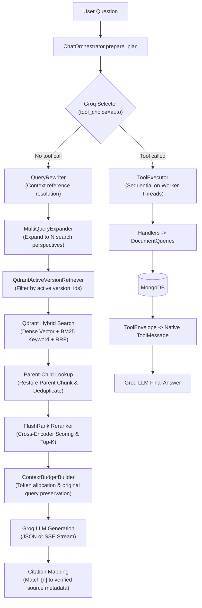

# RAG Workspace Backend

The **RAG Workspace Backend** is a **FastAPI** application structured as a **Modular Monolith** using **Ports and Adapters (Hexagonal Architecture)**. It handles document lifecycle management, parsing/chunking/embedding ingestion, **Advanced RAG** retrieval (Hybrid Search, Reranking, Parent-Child Chunking, Multi-Query Expansion), **Tool Use** via native function calling, persistent session management, and typed **Server-Sent Events (SSE)** streaming.

---

## 1. Technology Stack

- **Runtime**: Python 3.12 (verified on CI); Python 3.10+ compatible.
- **Web Framework**: FastAPI (`>=0.115.0`), Uvicorn (`>=0.32.0`), Pydantic Settings (`>=2.5.0`).
- **LLM & Orchestration**: LangChain Core (`>=1.2.0`), LangChain OpenAI (`>=1.0.0`) targeting **Groq API** (`openai/gpt-oss-120b`).
- **Embeddings**: LangChain Google GenAI (`>=4.0.0`) using **Google Gemini Embedding** (`gemini-embedding-001`).
- **Reranking**: FlashRank (`>=0.2.10` — local ONNX Cross-Encoder runtime) with optional Cohere Rerank support.
- **Databases & Storage**:
  - **MongoDB Atlas** (`pymongo>=4.10.0`): Source of truth for document metadata, versions, ingestion jobs, sessions, and message history.
  - **Qdrant Cloud** (`qdrant-client>=1.12.0`): Vector index for semantic search (Dense) and keyword matching (BM25/Text Match).
  - **Local Filesystem**: Immutable storage for raw uploaded binaries.
- **Document Loaders**: `pypdf>=5.0.0`, `openpyxl>=3.1.5`, `defusedxml>=0.7.1`, `unstructured[xlsx]`, `pandas`, `chardet`.

---

## 2. Architecture & Dependency Invariants

The source code inside `backend/app/` enforces strict unidirectional dependency boundaries verified automatically via AST tests in [`tests/architecture/test_dependency_rules.py`](tests/architecture/test_dependency_rules.py):

```text
backend/app/
├── main.py                      # FastAPI entry point, lifespan (Mongo/Qdrant init) & CORS
├── api/                         # HTTP transport & SSE layer (no domain logic)
│   ├── routes/                  # Endpoints: chat.py, documents.py, sessions.py
│   ├── schemas/                 # Pydantic DTOs: chat_documents.py, conversations.py
│   └── streaming/               # SSE wire protocol: sse_schema.py, event_adapter.py
├── chat/                        # Chat turn orchestration & RAG context preparation
│   ├── orchestrator.py          # ChatOrchestrator: routing (Tool vs RAG), deadlines, usage
│   ├── pipeline.py              # Shared prepared-request builder for JSON & SSE
│   ├── query_rewriting.py       # History-aware query rewriting with lexical grounding
│   ├── multi_query.py           # Multi-Query Expansion
│   ├── context_budget.py        # Token budgeting across system, history, chunks & reserve
│   ├── citation_mapping.py      # Maps [n] markers to verified chunk metadata
│   └── events.py, prompts.py    # Transport-agnostic stream events & system prompts
├── conversations/               # Session & message persistence domain (MongoDB)
│   ├── models.py, indexes.py, repository.py, service.py, history.py
├── documents/                   # Document lifecycle, versioning & attachments domain
│   ├── models.py, indexes.py, repository.py, service.py, queries.py
│   ├── ingestion.py             # Coordinates Upload -> Parse -> Embed -> Index
│   ├── ports.py                 # FileStorage abstract interface port
│   ├── tool_handlers.py         # Document tool schemas and handlers
│   └── excel/                   # Safe ZIP/XLSX validation & paginated preview
├── rag/                         # Infrastructure-agnostic technical RAG components
│   ├── loaders/                 # files.py (PDF/TXT/MD/DOCX), excel.py
│   ├── splitter.py              # RecursiveCharacter & Parent-Child chunking
│   ├── embeddings.py            # Google Gemini Embeddings factory
│   ├── indexing.py              # parse_and_split, embed_chunks, build_vector_records
│   ├── vector_index.py          # VectorIndex abstract port & VectorRecord
│   ├── retriever.py             # QdrantActiveVersionRetriever (filtering & parent lookup)
│   ├── reranker.py              # FlashRankReranker, CohereReranker, PassThroughReranker
│   └── llm.py, prompt.py, chain.py
├── tool_use/                    # Domain-agnostic safe tool execution engine
│   ├── contracts.py             # ToolCall, ToolEnvelope, byte limits & validation
│   └── executor.py              # ToolExecutor: sequential execution on worker threads
├── infrastructure/              # Concrete adapters for external services
│   ├── mongo.py, qdrant.py, connections.py, status.py
│   ├── storage.py               # LocalFileStorage (implements FileStorage)
│   └── qdrant_vector_index.py   # QdrantVectorIndex (implements VectorIndex & Hybrid RRF)
└── shared/                      # Centralized configuration (config.py)
```

### Unidirectional Dependency Rules
1. **`api`** $\rightarrow$ `chat`, `conversations`, `documents`, `shared` (never imports `infrastructure` directly).
2. **`chat`** $\rightarrow$ `rag`, `conversations`, `tool_use`, `shared` (unaware of `api` or `sse_schema.py`).
3. **`documents`** $\rightarrow$ `rag`, `tool_use`, `shared` (interacts with storage exclusively via `FileStorage` and `VectorIndex` ports).
4. **`rag`** $\rightarrow$ `shared` (purely technical; no imports from `chat`, `api`, or concrete Mongo/Qdrant clients).
5. **`tool_use`** $\rightarrow$ `shared` (completely decoupled from business domains).
6. **`infrastructure`** $\rightarrow$ `shared` (implements port interfaces).

Detailed refactoring records and ADRs are available in [`docs/refactoring/`](../docs/refactoring/REF-02-ARCHITECTURE-DECISIONS.md).

---

## 3. Core Workflows

### 3.1 Document Ingestion & Immutable Versioning
The system separates **Document Identity** from **Immutable Versions**:
- **Raw Storage**: Uploaded binaries are written immutably to `documents/{document_id}/{version_id}/original` via `LocalFileStorage`.
- **Lifecycle Status**: `PENDING` $\rightarrow$ `PROCESSING` $\rightarrow$ `INDEXED` (or `FAILED`).
- **Parsing**: Supports `.pdf` (page-by-page extraction), `.txt`, `.md`/`.markdown`, and `.xlsx` (10 MiB limit, ZIP/XML safety checks in `documents/excel/validation.py`, formulas preserved as literal strings).
- **Chunking**: Standard splitting (`chunk_size=500`, `chunk_overlap=50`) or **Parent-Child Chunking** (Parent ~1200 chars, Child ~300 chars storing `parent_id`/`parent_text` in payload).
- **Vectorization & Activation**: Gemini Embeddings $\rightarrow$ Qdrant upsert $\rightarrow$ Vector count verification $\rightarrow$ Atomic `active_version_id` update in MongoDB.

### 3.2 Advanced RAG Query Processing



### 3.3 Tool Use Orchestration
- **Intent Routing**: `ChatOrchestrator` binds schemas from `document_tool_definitions()` (`count_documents`, `list_documents`) to Groq LLM with `tool_choice="auto"` (15s timeout).
- **Safe Execution**: When tools are invoked, `ToolExecutor` runs handlers sequentially on worker threads (max 2 calls/turn, 10s stage budget, 5s per call, 64KB output limit).
- **Result Normalization**: Handlers in `documents/tool_handlers.py` validate arguments via Pydantic, shield internal database exceptions, and return a standardized `ToolEnvelope` wrapped into a LangChain `ToolMessage` for Groq's final answer synthesis.

### 3.4 Conversation Persistence & SSE Streaming
- **Atomic Turn Guard**: Persistent sessions in MongoDB enforce a single active generation lock per session; concurrent requests return HTTP `409 Conflict`.
- **History Reconstruction**: `ConversationHistoryLoader` loads only paired user + assistant turns with `COMPLETED` status sharing a `request_id`.
- **SSE Protocol**: `POST /chat/stream` emits typed events in strict order: `start` $\rightarrow$ `metadata` $\rightarrow$ `citation`* $\rightarrow$ `delta`* $\rightarrow$ `done` (or `error`).

---

## 4. API Organization

| Group | Method | Endpoint | Description |
| :--- | :--- | :--- | :--- |
| **Health** | `GET` | `/health` | Process and configuration health check |
| **Health** | `GET` | `/health/dependencies` | Checks MongoDB and Qdrant readiness (excludes Groq/Gemini) |
| **Documents** | `POST` | `/documents/upload` | Upload and index a new document (version 1) |
| **Documents** | `GET` | `/documents` | List documents with pagination and `include_deleted` toggle |
| **Documents** | `GET` | `/documents/{document_id}` | Document details and version history |
| **Documents** | `GET` | `/documents/{document_id}/versions/{version_id}/preview` | Preview immutable version (TXT/MD/XLSX; PDF unsupported) |
| **Documents** | `PUT` | `/documents/{document_id}` | Upload new file to create a new immutable version |
| **Documents** | `POST` | `/documents/{document_id}/re-index` | Re-index the active version from raw storage |
| **Documents** | `DELETE` | `/documents/{document_id}` | Unpublish document, delete Qdrant vectors, retain audit history |
| **Chat** | `POST` | `/chat` | Synchronous JSON chat (stateless or persistent via `session_id`) |
| **Chat** | `POST` | `/chat/stream` | Streaming SSE chat (supports up to 20 `attachments`) |
| **Sessions** | `POST` / `GET` | `/sessions` | Create session (`ALL_ACTIVE`) / List active sessions |
| **Sessions** | `GET` / `PATCH` / `DELETE` | `/sessions/{session_id}` | Get session (410 if deleted) / Rename / Soft-delete |
| **Sessions** | `GET` | `/sessions/{session_id}/messages` | Retrieve paginated message history ordered by `sequence` |

Interactive OpenAPI/Swagger documentation is available at `http://127.0.0.1:8000/docs` when running locally.

---

## 5. Environment Configuration (`.env`)

The Backend reads `.env` from the **project root directory** (see [`.env.example`](../.env.example)). Never commit `.env` to version control.

| Variable | Default | Description |
| :--- | :--- | :--- |
| **LLM & Tool Use** | | |
| `GROQ_API_KEY` | *(required)* | Groq Cloud API key |
| `OPENAI_BASE_URL` | `https://api.groq.com/openai/v1` | Groq OpenAI-compatible API endpoint |
| `LLM_MODEL` | `openai/gpt-oss-120b` | Chat and selector model name |
| `TOOL_USE_ENABLED` | `false` | Enables Groq Selector on the JSON `/chat` route |
| `TOOL_SELECTOR_TIMEOUT_SECONDS` | `15.0` | Timeout for the tool selection call |
| `CHAT_TURN_TIMEOUT_SECONDS` | `120.0` | Maximum overall deadline per chat turn |
| **Embedding & Chunking** | | |
| `EMBEDDING_PROVIDER` | `google` | Embedding provider |
| `EMBEDDING_API_KEY` | *(required)* | Google AI Studio API key |
| `EMBEDDING_MODEL` | `gemini-embedding-001` | Embedding model name |
| `CHUNK_SIZE` / `CHUNK_OVERLAP` | `500` / `50` | Standard character chunk size and overlap |
| `PARENT_CHILD_ENABLED` | `false` | Enables Parent-Child Hierarchical Chunking |
| `PARENT_CHUNK_SIZE` / `PARENT_CHUNK_OVERLAP` | `1200` / `100` | Parent chunk size and overlap |
| `CHILD_CHUNK_SIZE` / `CHILD_CHUNK_OVERLAP` | `300` / `30` | Child chunk size and overlap |
| **Retrieval, Hybrid, Rerank & Multi-Query** | | |
| `TOP_K` | `5` | Final number of chunks passed to LLM context |
| `HYBRID_SEARCH_ENABLED` | `false` | Enables Dense Vector + BM25 Keyword search |
| `HYBRID_RRF_K` | `60` | Smoothing constant for Reciprocal Rank Fusion |
| `RERANKER_ENABLED` | `false` | Enables post-retrieval Cross-Encoder reranking |
| `RERANKER_PROVIDER` | `flashrank` | `flashrank` (local ONNX) or `cohere` |
| `RERANKER_MODEL` | `ms-marco-TinyBERT-L-2-v2` | Reranker model identifier |
| `RERANKER_CANDIDATE_TOP_K` | `15` | Number of initial candidates fetched prior to reranking |
| `RERANKER_RELEVANCE_THRESHOLD` | `0.0` | Minimum relevance score threshold |
| `COHERE_API_KEY` | `None` | Required when `RERANKER_PROVIDER=cohere` |
| `MULTI_QUERY_ENABLED` | `false` | Enables LLM-based Multi-Query Expansion |
| `MULTI_QUERY_COUNT` | `3` | Number of alternative query perspectives generated |
| `MULTI_QUERY_TIMEOUT_SECONDS` | `10.0` | Timeout for query expansion call |
| **Context Budget & Streaming** | | |
| `RAG_CONTEXT_WINDOW_TOKENS` | `8192` | Total token window budget |
| `RAG_SYSTEM_MAX_TOKENS` | `1024` | Token allocation for system instruction |
| `RAG_HISTORY_MAX_TOKENS` | `2048` | Token allocation for whole-turn history |
| `RAG_CHUNKS_MAX_TOKENS` | `3584` | Token allocation for retrieved chunks |
| `RAG_QUERY_MAX_TOKENS` | `512` | Token allocation for current user query |
| `RAG_OUTPUT_RESERVE_TOKENS` | `1024` | Token reserve held for output generation |
| `STREAM_TIMEOUT_SECONDS` | `120.0` | Provider SSE streaming loop deadline |
| **Storage & Cloud Databases** | | |
| `DOCUMENTS_DIR` | `./data/documents` | Raw document root directory (resolved relative to `PROJECT_ROOT`) |
| `STORAGE_BACKEND` | `local` | Currently only supports `local` |
| `MONGODB_URI` / `MONGODB_DB_NAME` | *(required)* | MongoDB Atlas connection URI and database name |
| `MONGODB_TIMEOUT_MS` | `5000` | MongoDB connection timeout |
| `QDRANT_URL` / `QDRANT_API_KEY` | *(required)* | Qdrant Cloud HTTPS URL and API key |
| `QDRANT_COLLECTION` | `rag_documents` | Target vector collection name |
| `QDRANT_TIMEOUT_SECONDS` | `5.0` | Qdrant client timeout |

---

## 6. Installation & Local Development

Run all commands from the **repository root** (`rag-demo/`) so relative storage paths (`./data/documents`) and `.env` resolve correctly:

```powershell
# 1. Create and activate virtual environment
python -m venv .venv
.\.venv\Scripts\Activate.ps1

# 2. Install dependencies
pip install -r backend/requirements.txt

# 3. Copy environment template
if (!(Test-Path .env)) { Copy-Item .env.example .env }

# 4. Verify cloud connectivity (optional)
python backend/scripts/check_cloud_connections.py

# 5. Start FastAPI development server
python -m uvicorn app.main:app --app-dir backend --reload --port 8000
```

> **CORS Note**: FastAPI CORS middleware strictly permits `http://localhost:3000` and `http://127.0.0.1:3000` (`credentials=False`).

---

## 7. Testing & Evaluation

All offline test suites operate without live cloud or LLM provider calls:

```powershell
Set-Location backend

# 1. Static AST Architecture Rules
python -m unittest discover -s tests/architecture -v

# 2. Unit Tests (RAG, Reranker, Hybrid Search, Parent-Child, Multi-Query, Tool Use)
python -m unittest discover -s tests/unit -v

# 3. Offline Integration Tests
python -m unittest discover -s tests/integration -v

# 4. Offline Smoke Tests
Set-Location ..
$env:PYTHONPATH = "backend"
python backend/tests/smoke/smoke_sse_schema.py
python backend/tests/smoke/smoke_context_budget.py
python backend/tests/smoke/smoke_query_rewriting.py
```

### RAG Evaluation
The `backend/evaluation/` directory contains offline/online evaluation datasets and scoring runners. By default, evaluation targets a separate Qdrant collection (`rag_documents_eval`) to isolate application data.
