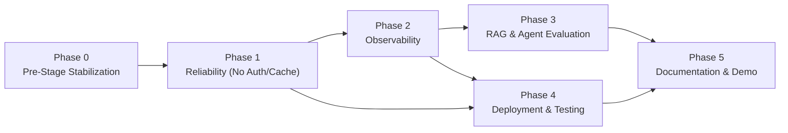

# RAG Workspace Readiness — Implementation Plan & Task Tracking

> **Trạng thái ký hiệu:** `[ ]` Chưa làm · `[/]` Đang thực hiện · `[x]` Hoàn thành · `[!]` Bị chặn · `[-]` Tạm hoãn (Deferred)  
> **Tài liệu căn cứ:** [`BASELINE_AUDIT.md`](../../BASELINE_AUDIT.md) (2026-11-27) & đối chiếu backlog lịch sử [`task/Task.md`](../Task.md).  
> **Mục tiêu kế hoạch:** Đưa dự án RAG Workspace sang trạng thái **ổn định, tin cậy, quan sát được, đánh giá định lượng trung thực, đóng gói Local/Demo hoàn chỉnh và tài liệu hóa chuẩn xác**, ưu tiên tái sử dụng tối đa mã nguồn sẵn có và tránh overengineering.

---

## 1. Tổng quan Phân loại Hiện trạng & Ràng buộc Kiến trúc

### 1.1 Bảng tóm tắt phân loại & quyết định phạm vi (cập nhật sau Review)

| Nhóm năng lực | Trạng thái hiện tại | Quyết định trong kế hoạch này |
| :--- | :--- | :--- |
| Lõi RAG, Document Versioning (Local/S3), Turn Guard, Context Budget, Query Rewriting | **Verified** | **Giữ nguyên**, bảo vệ bằng regression tests (không làm lại) |
| Typed SSE Wire Protocol, JSON/SSE Terminal Parity, Frontend DTO Contract (63 schemas) | **Verified** | **Giữ nguyên**; chỉ tích hợp `status` frame ở `T2.4` nếu 100% không phá vỡ contract |
| Excel Safe Validation, Parquet Ingestion, DuckDB `run_sql` + `sqlglot` AST Guard | **Tested** | **Thống nhất 1 công cụ Excel (`run_sql`)** hỗ trợ cả Local & S3 (`T0.3`) + đánh giá ở Phase 3 |
| HR Demo Portal UI (`/hr`, `/hr/documents`, `/hr/guide`), `DocumentScopeSelector` | **Tested** | **Giữ nguyên UI**; bổ sung Playwright E2E, mock parity & kịch bản demo dữ liệu giả lập |
| Backend Test Isolation (111 tests fail khi `.env` local bật flags) | **Partially Implemented** (Lỗi cô lập) | **Xử lý ngay ở Phase 0 (`T0.2`)** bằng cơ chế tương thích trực tiếp `unittest` |
| Agentic Mode (`active_version_ids`, `loaded.scope`, đồng bộ schema–handler) | **Partially Implemented** (Lỗi nối dây) | **Xử lý ngay ở Phase 0 (`T0.3`)** |
| Corrective RAG (Retrieval Grading, Query Correction/Retry & Safe Fallback) | **Partially Implemented** (Chưa nối LLM) | **Xử lý ở Phase 0 (`T0.4`)**; tách `EvidenceEvaluator` sang Phase 3; Web Search → **Deferred** |
| `/health/dependencies` (required vs optional, non-destructive), Upload cap, Rate Limiter, Timeouts, CORS | **Partially Implemented** | **Xử lý ở Phase 1 (`T1.1`–`T1.3`)** |
| Langfuse (SDK check + redaction), Structured JSON Logging, `X-Request-ID`, `prometheus-client` `/metrics` | **Partially Implemented / Missing** | **Xử lý ở Phase 2 (`T2.1`–`T2.4`)** |
| Golden Datasets, Custom RAG Metrics + `CustomLlmJudge`, Agent/SQL Eval (Offline vs Live), Benchmark A/B/C | **Partially Implemented / Missing** | **Xử lý ở Phase 3 (`T3.1`–`T3.4`)** |
| Docker Hardening, 1 bộ `docker-compose.yml` Local/Demo + ARQ Worker, Phân loại 16 `smoke_*.py`, E2E, CI + Audit | **Partially Implemented / Missing** | **Xử lý ở Phase 4 (`T4.1`–`T4.4`)** |
| Tài liệu trung thực theo mức `Verified`, Safe Seed Script (`--dry-run`, tách collection) & Demo Runbook | **Partially Implemented / Missing** | **Xử lý ở Phase 5 (`T5.1`–`T5.2`)** |
| Authentication/JWT/RBAC/IDOR, **Semantic Cache**, **Web Search Fallback**, Backend Refactoring, Inline PDF Viewer | **Partially Implemented / Missing** | **Deferred / Future** (khóa cờ mặc định `false`, không làm phình phạm vi hiện tại) |

### 1.2 Hạng mục Đã Hoàn Thiện — Không Làm Lại & Bắt Buộc Bảo Toàn (Regression Guardrails)
Mọi task bên dưới **tuyệt đối không viết lại hoặc làm suy giảm** các bất biến đã `Verified`/`Tested` sau:
1. **Hexagonal Dependency Rules:** `backend/tests/architecture/test_dependency_rules.py` luôn PASS `9/9`.
2. **Backend Core Suites:** Toàn bộ `332` unit tests, `181` integration tests và `3` offline smoke scripts (`smoke_sse_schema.py`, `smoke_context_budget.py`, `smoke_query_rewriting.py`) luôn PASS 100% offline (không gọi Groq/Gemini/Cohere/Qdrant Cloud thật).
3. **Frontend Suites & Contract Parity:** `npm.cmd run test:contract` (`63` schemas), `npm.cmd run typecheck`, `npm.cmd run lint`, và `npm.cmd test` (`237` Node tests) luôn PASS 100%; tách biệt hoàn toàn `app/(workspace)/` và `app/hr/`.
4. **Immutable Versioning & Excel SQL Sandbox:** Giữ nguyên cơ chế version bất biến, giới hạn an toàn `read_workbook()` (`10 MiB`, zip-bomb, macro block), `sqlglot` AST whitelist và DuckDB `lock_configuration=true` + `disabled_filesystems='LocalFileSystem'`.

### 1.3 Sơ đồ Phụ thuộc giữa các Phase

---

## Phase 0 — Pre-Stage Stabilization
**Mục tiêu:** Rà soát và phân loại rõ các thay đổi dở dang trên working tree, cô lập cấu hình kiểm thử tương thích chuẩn với `unittest`, thống nhất công cụ Excel `run_sql` đồng bộ cho cả Local/S3 trên Agentic Orchestrator, và hoàn thiện luồng Corrective RAG gọn nhẹ (Grading + Retry + Safe Fallback).

### Danh sách Task

- [x] **T0.1 — Rà soát Working Tree Diff, Phân loại Thay đổi & Đề xuất Nhóm Commit**
  - **Phụ thuộc:** Không.
  - **Files kiểm tra (chỉ đọc/phân tích, không tự ý commit):** `.gitattributes`, `.githooks/commit-msg`, `.githooks/pre-commit`, `GEMINI.md`, `backend/app/documents/excel/sql_service.py` (dòng 844–852: `DocumentRepository` → `MongoDocumentRepository`), `backend/tests/integration/test_chat_sql_routing.py`.
  - **Nội dung triển khai:**
    - Kiểm tra chi tiết từng hunk diff đang staged và unstaged trên working tree (đảm bảo không lọt secret, debug code hay thay đổi ngoài ý muốn).
    - Phân loại thành các nhóm commit độc lập theo đúng phạm vi chức năng (ví dụ: Nhóm 1 — Git hooks & repo guidelines; Nhóm 2 — Bugfix `create_excel_sql_service` + integration test `test_chat_sql_routing.py`) kèm câu lệnh `git add`/`git commit` đề xuất để người dùng xác nhận trước khi thực hiện commit.
    - **Quy tắc cứng:** Không tự ý chạy `git commit` hay `git reset` khi chưa có xác nhận.
  - **Acceptance Criteria:**
    - Có bảng phân loại đầy đủ từng file đang dirty trên working tree, xác nhận bản sửa `MongoDocumentRepository` tại `sql_service.py` pass test liên quan, và danh sách commit đề xuất rõ ràng để duyệt.

- [x] **T0.2 — Cô lập Cấu hình Kiểm thử Backend Tương Thích Chuẩn `unittest`**
  - **Phụ thuộc:** T0.1.
  - **Files tạo/sửa:** `backend/tests/_test_env.py` (tạo mới), `backend/tests/__init__.py`, `backend/tests/unit/__init__.py`, `backend/tests/integration/__init__.py`, `backend/tests/architecture/__init__.py` (và rà soát các test đang sửa trực tiếp `settings` nếu có).
  - **Nội dung triển khai:**
    - Không dùng cơ chế `conftest.py` của `pytest` (do dự án chạy `python -m unittest discover -s tests/unit -v` từ `backend/` và từ repo root, lúc đó `top_level_dir` có thể là `tests/unit` khiến `tests/__init__.py` không tự chạy nếu không import tường minh).
    - Xây dựng `backend/tests/_test_env.py` được import idempotent ngay dòng đầu của `tests/__init__.py`, `tests/unit/__init__.py`, `tests/integration/__init__.py`, `tests/architecture/__init__.py`:
      - Khởi tạo lại `Settings(_env_file=None, ...)` với bộ giá trị mặc định chuẩn CI (tất cả feature flags nâng cao = `false`, `storage_backend="local"`, dummy keys hợp lệ format) và cập nhật đồng bộ vào `app.shared.config.settings` + `get_settings` trước khi bất kỳ test module nào import code ứng dụng.
      - Cung cấp context manager `override_settings(**kwargs)` dùng chung cho `unittest.TestCase` / `IsolatedAsyncioTestCase`, tự động hoàn trả trạng thái `settings` gốc trong khối `finally`.
  - **Acceptance Criteria:**
    - Giữ nguyên file `.env` cá nhân đang bật `AGENTIC_MODE_ENABLED=true`, `EXCEL_SQL_ENABLED=true`, `STORAGE_BACKEND=s3`, chạy trực tiếp `python -m unittest discover -s tests/unit -v` (từ `backend/`) và `python -m unittest discover -s backend/tests/unit -v` (từ root) đều **PASS 332/332**, và `tests/integration` **PASS 181/181**.

- [x] **T0.3 — Chuẩn hóa Agentic Orchestrator & Thống nhất Một Công cụ Excel (`run_sql` cho cả Local & S3)**
  - **Phụ thuộc:** T0.2.
  - **Files sửa:** `backend/app/shared/config.py:461-473`, `backend/app/infrastructure/duckdb_executor.py:79-198, 280-296, 339-357`, `backend/app/documents/excel/sql_service.py:838-854`, `backend/app/chat/orchestrator.py:481-550, 668-713`, `backend/app/chat/agent_tools.py:54-93`, `backend/app/chat/agent.py:18-26`.
  - **Files test:** `backend/tests/unit/test_duckdb_executor.py`, `backend/tests/unit/test_agentic_orchestrator.py`, `backend/tests/integration/test_chat_sql_routing.py`, `backend/tests/integration/test_chat_json_tools.py`, `backend/tests/integration/test_chat_stream_tools.py`.
  - **Nội dung triển khai:**
    1. **Sửa `session_scope` & nạp `active_version_ids` cho nhánh `AGENTIC`:**
       - Tại `orchestrator.py:487`, sửa `getattr(loaded, "retrieval_scope", None)` thành `loaded.scope` (`LoadedHistory.scope`).
       - Nạp `active_version_ids` từ `MongoDocumentRepository(database)` theo `session_scope` trong `prepare_plan` và truyền vào `PreparedChatAnswer(..., active_version_ids=active_version_ids)` để `rag_search` truy xuất đúng tài liệu đang `INDEXED` và tôn trọng `SELECTED_DOCUMENTS`.
    2. **Mở rộng `DuckDBSqlExecutor` chạy đồng nhất cho cả `STORAGE_BACKEND=local` và `s3`:**
       - Cho phép `EXCEL_SQL_ENABLED=true` hoạt động với cả `STORAGE_BACKEND=local` (chỉ yêu cầu `AGENTIC_MODE_ENABLED=true` và `EXCEL_PARQUET_INGESTION_ENABLED=true`, vốn `IngestionService._ingest_excel_parquet_and_catalog` đã hỗ trợ sẵn trên `LocalFileStorage`).
       - Khi `version` hoặc cấu hình ở chế độ `local`, `DuckDBSqlExecutor` nhận callback/storage đọc bytes Parquet được cấp quyền (`storage.get(tbl.parquet_key)`) nạp qua `pyarrow.parquet.read_table(io.BytesIO(...))` vào Temp View **trước khi** gọi `_apply_security_lockdown(conn)` — nhờ đó bên trong DuckDB vẫn giữ nguyên khóa cứng `SET disabled_filesystems = 'LocalFileSystem'` và `SET lock_configuration = true` (SQL của LLM tuyệt đối không đọc được đĩa host). Khi `STORAGE_BACKEND=s3` giữ nguyên cơ chế `httpfs` + read-only S3 secret.
    3. **Bảo đảm đồng bộ 1-1 giữa Tool Schema và Handler Registry:**
       - Sử dụng **`run_sql` làm công cụ phân tích bảng Excel duy nhất trên production**; cập nhật `AGENT_SYSTEM_INSTRUCTION` và sinh `schemas` trực tiếp từ đúng tập công cụ có mặt trong `registry` (`query_excel_table` không còn xuất hiện trên production khi không truyền `excel_loader_fn`, chỉ giữ tương thích ngược cho các unit test độc lập của nó).
  - **Acceptance Criteria:**
    - Integration test xác nhận `run_sql` thực thi thành công câu hỏi tính toán Excel ở **cả hai chế độ `STORAGE_BACKEND=local` và `STORAGE_BACKEND=s3`**, trong khi `read_parquet('/etc/passwd')` vẫn bị chặn ở cả `sql_guard` lẫn DuckDB sandbox.
    - Integration test xác nhận `rag_search` và `run_sql` trong nhánh `AGENTIC` đều lọc chính xác theo `SessionScopeMode.SELECTED_DOCUMENTS`.
    - Tập tên tool trong `schemas` gửi cho LLM luôn khớp chính xác 100% với `registry.keys()`.

- [x] **T0.4 — Hoàn thiện Corrective RAG Gọn Nhẹ (Grading + Query Retry + Safe Fallback)**
  - **Phụ thuộc:** T0.2.
  - **Files sửa:** `backend/app/rag/llm.py`, `backend/app/chat/corrective.py`, `backend/app/chat/pipeline.py:200-225`.
  - **Files test:** `backend/tests/unit/test_corrective_rag.py`, `backend/tests/integration/test_rag_integration.py`.
  - **Nội dung triển khai:**
    - Bổ sung factory `get_grader_llm()` trong `app/rag/llm.py` dùng `settings.corrective_grader_model` trên Groq API (cùng timeout/retry chuẩn).
    - Khi `CORRECTIVE_RAG_ENABLED=true`, nối `RetrievalGrader(llm=get_grader_llm())` và `QueryCorrector(llm=get_grader_llm())` vào `CorrectiveRagRunner` tại `pipeline.py` (tự động fallback về heuristic nếu LLM grader timeout/lỗi định dạng).
    - **Giới hạn phạm vi rõ ràng:** Khi hết số lượt retry (`corrective_max_retries`) mà tài liệu vẫn `IRRELEVANT`, kích hoạt **Strict Safe Fallback** (trả context rỗng để LLM từ chối an toàn, không bịa đặt). **Không nối Web Search fallback** (`WEB_SEARCH_FALLBACK_ENABLED` chuyển sang Deferred) và **không chặn luồng runtime bằng `EvidenceEvaluator`** (đưa `EvidenceEvaluator` sang phục vụ chấm điểm độc lập ở Phase 3).
  - **Acceptance Criteria:**
    - Unit & integration tests chứng minh khi `CORRECTIVE_RAG_ENABLED=true`: (1) tài liệu phù hợp đi thẳng qua 1 lần grade, (2) tài liệu lệch được `QueryCorrector` viết lại truy vấn tối đa `corrective_max_retries` lần trong `turn_deadline`, (3) hết retry vẫn không khớp thì kích hoạt safe fallback không hallucinate.
    - `tests/architecture` PASS `9/9`.

---

## Phase 1 — Reliability (Tạm hoãn Authentication/RBAC & Semantic Cache)
**Mục tiêu:** Củng cố độ tin cậy vận hành: healthcheck không đóng nhầm connection pool và phân tách rõ phụ thuộc bắt buộc/tùy chọn, giới hạn dung lượng upload chống tràn RAM, làm rõ chính sách lỗi Redis & xác thực IP an toàn cho Rate Limiter, và khóa chặt timeouts/secrets/CORS/startup guard.

### Danh sách Task

- [x] **T1.1 — Sửa `/health/dependencies` Không Phá Hủy & Phân Tách Dependencies Bắt buộc / Tùy chọn**
  - **Phụ thuộc:** Phase 0.
  - **Files sửa:** `backend/app/infrastructure/mongo.py`, `backend/app/infrastructure/qdrant.py`, `backend/app/infrastructure/connections.py`, `backend/app/main.py:75-83`.
  - **Files test:** `backend/tests/unit/test_cloud_connections.py`, `backend/tests/integration/test_controlled_live_guards.py`.
  - **Nội dung triển khai:**
    - Tách phương thức `check_health() -> ConnectionStatus` khỏi `connect()` trên `MongoDBConnection` và `QdrantConnection` (có `threading.Lock` bảo vệ khi `self.client is None`): nếu client đang mở, chỉ gọi lệnh kiểm tra nhẹ (`admin.command("ping")` / `get_collections()`) trên client hiện hữu, **tuyệt đối không gọi `self.close()`** làm đứt request đang chạy song song.
    - Phân loại rõ trong `/health/dependencies`:
      - **Required dependencies (`mongodb`, `qdrant`):** Luôn kiểm tra; nếu bất kỳ dịch vụ bắt buộc nào lỗi → tổng thể `status="degraded"` và trả HTTP `503`.
      - **Optional / Conditional dependencies (`redis`, `s3`):** Chỉ kiểm tra khi tính năng tương ứng đang bật (`redis` khi `RATE_LIMIT_ENABLED=true` hoặc `ASYNC_INGESTION_ENABLED=true`; `s3` khi `STORAGE_BACKEND=s3`). Nếu `ASYNC_INGESTION_ENABLED=true` hoặc `STORAGE_BACKEND=s3` bị lỗi kết nối thì đánh dấu `503` (vì chức năng ghi chính phụ thuộc vào chúng); nếu chỉ bật `RATE_LIMIT_ENABLED=true` mà Redis tạm đứt thì báo trạng thái phụ thuộc cảnh báo nhưng hệ thống chính vẫn giữ `200` theo đúng failure policy ở `T1.2`.
    - Bảo toàn tương thích ngược với cấu trúc đọc `dependencies.mongodb` và `dependencies.qdrant` của Frontend (`service-health.tsx` & `npm.cmd run test:contract`).
  - **Acceptance Criteria:**
    - Test đa luồng chứng minh gọi `/health/dependencies` liên tục không đóng instance `MongoClient`/`QdrantClient` đang phục vụ request.
    - Test xác nhận đúng mã HTTP `200`/`503` cho từng tổ hợp lỗi của Required vs Optional dependencies; `npm.cmd run test:contract` PASS.

- [x] **T1.2 — Giới hạn Dung lượng Upload (`413 Content Too Large`), Chính sách Lỗi Redis & Xác định Client IP An Toàn sau Reverse Proxy**
  - **Phụ thuộc:** T1.1.
  - **Files sửa:** `backend/app/shared/config.py`, `.env.example`, `backend/app/api/schemas/chat_documents.py`, `backend/app/api/dependencies/client_ip.py`, `backend/app/api/routes/documents.py`, `backend/app/api/routes/chat.py`, `backend/app/infrastructure/semantic_cache.py`, `frontend/lib/api/error-ux.ts`.
  - **Files test:** `backend/tests/integration/test_documents_api.py`, `backend/tests/unit/test_rbac_and_cache.py`, `frontend/tests/error-health.test.mjs`, `frontend/tests/document-upload.test.mjs`.
  - **Nội dung triển khai:**
    1. **Giới hạn dung lượng upload đa định dạng (HTTP `413 Content Too Large`):** Thêm `max_upload_bytes: int = 25 * 1024 * 1024` (`MAX_UPLOAD_BYTES=26214400`, giữ nguyên ngưỡng chặt hơn `MAX_XLSX_BYTES=10 MiB` cho `.xlsx`). Trong `_read_upload()`, đọc tối đa `limit + 1` bytes cho cả `.pdf`, `.txt`, `.md`, `.markdown`, `.xlsx` và trả thống nhất HTTP **`413 Content Too Large`** khi vượt ngưỡng (khai báo `HTTPErrorResponse` trên OpenAPI `POST /documents/upload` & `PUT /documents/{document_id}`, đồng bộ xử lý mã `413` ở Frontend `safeApiErrorMessage`; giữ nguyên HTTP `400` cho file rỗng, sai định dạng hoặc hỏng cấu trúc workbook).
    2. **Chuẩn hóa Redis Rate Limiter & Failure Policy:**
       - Chuyển thao tác tăng bộ đếm trên Redis sang Lua script atomic (`INCR` + gán `EXPIRE` nếu `count == 1` hoặc `TTL < 0`) để không bao giờ sinh key mồ côi không có TTL.
       - **Redis Failure Policy rõ ràng:**
         - Với **Rate Limiter (`RedisRateLimiter`)**: Khi Redis timeout/mất kết nối, ghi log `WARNING` (có tiết lưu tránh ngập log) và **chuyển sang bộ đếm in-memory cục bộ có giới hạn kích thước (bounded dict tối đa ví dụ 10.000 keys theo cửa sổ thời gian)** thay vì bỏ trống bảo vệ hoàn toàn hay đánh sập `/chat` bằng lỗi `500`.
         - Với **Async Ingestion Queue (`ArqIngestionQueue`)**: Khi `ASYNC_INGESTION_ENABLED=true` mà Redis lỗi, giữ nguyên **fail-closed (`503`)** và đánh dấu job lỗi an toàn để không mất tài liệu âm thầm.
    3. **Xác định Client IP an toàn sau Reverse Proxy:**
       - Thêm cấu hình `trusted_proxy_ips: tuple[str, ...] = ()` (`TRUSTED_PROXY_IPS=""` mặc định rỗng).
       - Viết hàm `resolve_client_ip(request, trusted_proxy_ips)`: mặc định luôn lấy `request.client.host`; **chỉ đọc IP đầu chuỗi/hợp lệ từ `X-Forwarded-For` khi `request.client.host` nằm trong danh sách `trusted_proxy_ips`**, ngăn chặn hoàn toàn việc client tự gắn header `X-Forwarded-For` giả mạo để vượt qua rate limit trên cả `/chat`, `/chat/stream` và upload tài liệu.
  - **Acceptance Criteria:**
    - Upload `.pdf`/`.txt` vượt `max_upload_bytes` bị chặn ngay ở byte `limit + 1`.
    - Test chứng minh header `X-Forwarded-For` giả mạo bị bỏ qua khi `request.client.host` không thuộc `TRUSTED_PROXY_IPS`, và được trích xuất đúng khi đi qua proxy tin cậy.
    - Test chứng minh khi Redis sập giữa chừng, `RedisRateLimiter` tự động áp dụng fallback in-memory bounded mà không văng exception `500`.

- [x] **T1.3 — Hardening Timeouts/Retries cho Providers, `SecretStr`, CORS Động, Security Headers & Startup Guard**
  - **Phụ thuộc:** T1.1.
  - **Files sửa:** `backend/app/shared/config.py`, `.env.example`, `backend/app/rag/llm.py`, `backend/app/rag/embeddings.py`, `backend/app/main.py:50-63`.
  - **Files test:** `backend/tests/unit/test_llm.py`, `backend/tests/integration/test_cors.py`.
  - **Nội dung triển khai:**
    - Chuyển `embedding_api_key` trong `Settings` (`config.py:35`) sang `SecretStr` và cập nhật `embeddings.py` gọi `.get_secret_value()`.
    - Thêm cấu hình `llm_request_timeout_seconds: float = 60.0`, `llm_max_retries: int = 2`, `embedding_timeout_seconds: float = 30.0` và truyền tường minh vào `ChatOpenAI(...)` (`get_llm` & `get_grader_llm`) cùng `GoogleGenerativeAIEmbeddings(...)`.
    - Thay danh sách cứng `allow_origins` trong `main.py` bằng cấu hình `cors_origins: tuple[str, ...]` (`CORS_ORIGINS=http://localhost:3000,http://127.0.0.1:3000` mặc định).
    - Bổ sung middleware gắn các HTTP security headers an toàn (`X-Content-Type-Options: nosniff`, `X-Frame-Options: DENY`, `Referrer-Policy: strict-origin-when-cross-origin`).
    - Thêm `@model_validator` startup guard trong `Settings`: chặn khởi động ngay lập tức nếu `auth_enabled=True` mà `jwt_secret_key` vẫn mang giá trị mặc định yếu (không triển khai thêm bất kỳ logic Auth/RBAC nào khác).
  - **Acceptance Criteria:**
    - `repr(settings)` và `settings.model_dump()` ẩn hoàn toàn `embedding_api_key`.
    - Khởi tạo `Settings(auth_enabled=True)` với secret mặc định raise `ValidationError` rõ ràng.
    - `test_cors.py`, `test_llm.py` và toàn bộ regression tests PASS.

---

## Phase 2 — Observability
**Mục tiêu:** Thiết lập hệ thống quan sát chuẩn mực, an toàn dữ liệu: structured JSON logs không rò rỉ dữ liệu nhạy cảm, kiểm tra chặt `X-Request-ID`, đồng bộ Langfuse SDK kèm chính sách redaction, metrics chuẩn qua `prometheus-client` với low-cardinality labels, và đánh giá tích hợp có điều kiện cho SSE Status Events.

### Danh sách Task

- [x] **T2.1 — Structured JSON Logging, Validate `X-Request-ID` & Chính sách Cấm Log Dữ liệu Nhạy cảm**
  - **Phụ thuộc:** Phase 1.
  - **Files tạo/sửa:** `backend/app/shared/observability.py` (`request_id_var`), `backend/app/infrastructure/logging_config.py` (tạo mới), `backend/app/main.py`, `backend/app/api/routes/chat.py`.
  - **Files test:** `backend/tests/unit/test_observability.py`, `backend/tests/integration/test_chat_stream.py`.
  - **Nội dung triển khai:**
    - Thêm cấu hình `LOG_LEVEL=INFO`, `LOG_FORMAT=json` (`json` | `text`) vào `config.py` & `.env.example`.
    - Xây dựng HTTP Middleware xử lý `X-Request-ID`:
      - **Validate nghiêm ngặt:** Chỉ chấp nhận `X-Request-ID` gửi từ ngoài nếu là chuỗi ASCII an toàn khớp regex `^[A-Za-z0-9._-]{1,64}$`; nếu thiếu, rỗng, quá 64 ký tự hoặc chứa ký tự điều khiển/xuống dòng (`\r`, `\n` — chống log injection) thì bỏ qua và tự sinh UUIDv4 mới.
      - Gắn vào `contextvars` để mọi bản ghi log trong vòng đời request tự động có trường `request_id`, đồng thời trả lại header `X-Request-ID` trên HTTP response.
    - **Chính sách bảo mật log:** Rà soát và áp bộ lọc che (redact) các pattern khóa bí mật (`gsk_`, `AIza`, `sk-lf-`, `mongodb+srv://`, `Bearer `) trong log formatter; nghiêm cấm log câu hỏi người dùng, câu trả lời LLM, nội dung tài liệu, hay giá trị dòng Excel.
  - **Acceptance Criteria:**
    - Test gửi header `X-Request-ID` độc hại (chứa `\n`, ký tự lạ hoặc dài > 64 ký tự) xác nhận server tự thay thế bằng UUIDv4 sạch và trả về trong response header.
    - Test xác nhận JSON log xuất 1 dòng hợp lệ, có `request_id` và tự động che các chuỗi khớp định dạng API key/URI nếu vô tình xuất hiện trong exception message.

- [x] **T2.2 — Kiểm chứng Tương thích Langfuse SDK, Nối Đủ Luồng Chat & Kiểm soát Dữ liệu Tracing (Redaction)**
  - **Phụ thuộc:** T2.1.
  - **Files sửa:** `backend/requirements.txt`, `backend/app/shared/config.py`, `.env.example`, `backend/app/infrastructure/observability.py`, `backend/app/chat/pipeline.py`, `backend/app/api/routes/chat.py`.
  - **Files test:** `backend/tests/unit/test_observability.py`, `backend/tests/integration/test_rag_integration.py`.
  - **Nội dung triển khai:**
    - **Kiểm tra tương thích SDK thực tế:** Đối chiếu trực tiếp chữ ký hàm của gói `langfuse` với `LangfuseTracer` (`infrastructure/observability.py` hiện dùng API v2 `.trace()` / `.span()` / `.end()`; trong khi `langfuse>=3.0` đổi sang OpenTelemetry API khác hẳn). Pin chính xác dải phiên bản tương thích (`langfuse>=2.50.0,<3.0.0`) trong `backend/requirements.txt` và viết test kiểm tra import + khởi tạo client offline không lỗi.
    - **Chính sách Redaction & Kiểm soát dữ liệu gửi lên Langfuse:**
      - Thêm cờ `langfuse_trace_content_enabled: bool = False` (`LANGFUSE_TRACE_CONTENT_ENABLED=false` mặc định).
      - Khi cờ ở mức mặc định `false`: `LangfuseTracer`/`LangfuseSpan` tự động lược bỏ hoặc thay thế nội dung văn bản nhạy cảm (prompt, câu hỏi gốc, đoạn chunk, câu trả lời) bằng metadata định lượng an toàn (`char_length`, `chunk_count`, `source_count`, `tool_names`, `latency_ms`, `usage`, `error_code`); đồng thời quét redact mọi chuỗi giống API key/URI/token trước khi gửi SDK. Chỉ gửi nội dung text rút gọn (đã qua bộ lọc redact secret) khi quản trị viên chủ động bật `LANGFUSE_TRACE_CONTENT_ENABLED=true`.
    - Truyền `request.app.state.tracer` đầy đủ vào tất cả các nhánh của `/chat` và `/chat/stream` (bao gồm cả stateless và non-tool), và sửa `pipeline.py` dùng đúng context manager `with active_trace:` khi sở hữu trace.
  - **Acceptance Criteria:**
    - `pip check` PASS; test khởi tạo `LangfuseTracer` với gói `langfuse` thực tế đã cài trong `.venv` (với HTTP transport bị chặn/mock) xác nhận đúng chữ ký hàm SDK.
    - Unit test xác nhận khi `LANGFUSE_TRACE_CONTENT_ENABLED=false`, không có chuỗi câu hỏi hay câu trả lời thô nào lọt xuống `sdk_client.trace` / `sdk_span.end`.

- [x] **T2.3 — Operational Metrics qua `prometheus-client` với Low-Cardinality Labels**
  - **Phụ thuộc:** T2.1.
  - **Files sửa/tạo:** `backend/requirements.txt` (thêm `prometheus-client>=0.21.0,<1.0.0`), `backend/app/infrastructure/metrics.py` (tạo mới mỏng bọc `prometheus_client`), `backend/app/main.py`, `backend/app/api/streaming/stream_metrics.py`, `backend/app/chat/pipeline.py`.
  - **Files test:** `backend/tests/unit/test_observability.py`, `backend/tests/unit/test_stream_metrics.py`.
  - **Nội dung triển khai:**
    - Sử dụng trực tiếp thư viện chuẩn **`prometheus-client`** (`Counter`, `Histogram`, `CollectorRegistry`), không tự viết framework metrics thủ công.
    - Định nghĩa bộ metrics tinh gọn với **labels có cardinality thấp và hữu hạn**:
      - `rag_http_requests_total` & `rag_http_request_duration_seconds` — labels: `method`, `route` (lấy từ `request.scope["route"].path` như `/documents/{document_id}`, fallback `"unmatched"` cho 404 để tránh nổ cardinality từ URL rác), `status_code`.
      - `rag_chat_turns_total` — labels: `transport` (`json`|`sse`), `mode` (`stateless`|`persistent`), `route_type` (`rag`|`document_tools`|`agentic`), `outcome`.
      - `rag_chat_ttft_seconds` (Histogram cho SSE `first_content_ms`) & `rag_stage_duration_seconds` — label: `stage` (`rewrite`|`multi_query`|`retrieval`|`rerank`|`corrective`|`sql`|`generation`).
      - `rag_llm_tokens_total` — label: `direction` (`input`|`output`).
      - **Quy tắc cứng:** Tuyệt đối không đưa `request_id`, `session_id`, `document_id`, `user_id` hay tên file làm label.
    - Mở endpoint `GET /metrics` (`include_in_schema=False` để giữ nguyên 63 schemas OpenAPI của Frontend), điều khiển qua cờ `METRICS_ENABLED=true`.
  - **Acceptance Criteria:**
    - Gọi `GET /metrics` trả đúng chuẩn exposition của `prometheus_client`; gọi thử 50 URL 404 ngẫu nhiên chỉ gom vào đúng 1 chuỗi label `route="unmatched"`; `npm.cmd run test:contract` PASS.

- [-] **T2.4 — Tích hợp Có Điều Kiện SSE `status` Events (Zero Contract Breakage Gate — Chuyển Deferred theo Cổng Quyết Định)**
  - **Phụ thuộc:** T0.3, T0.4, T2.1.
  - **Files dự kiến kiểm tra/sửa:** `backend/app/api/routes/chat.py`, `backend/app/chat/orchestrator.py`, `frontend/types/chat.ts`, `frontend/lib/sse/parser.ts`, `frontend/lib/api/chat.ts`, `frontend/tests/verify-api-contract.mjs`.
  - **Nội dung triển khai & Cổng Quyết Định (Decision Gate):**
    - Kiểm tra khả năng mở rộng additive sự kiện `event: status` (`SSEStatusEvent` đã có sẵn ở `backend/app/api/streaming/sse_schema.py:100`) sang `KNOWN_EVENTS` của `frontend/lib/sse/parser.ts` và `frontend/lib/api/chat.ts` mà chỉ bỏ qua/cập nhật nhãn trạng thái phụ, giữ nguyên hoàn toàn mảng `deltas`, `sequence` liên tục, `SSETranscript` và logic reconciliation/recovery của `ChatController`.
    - **Quy tắc chống phức tạp hóa:** Nếu trong bước thiết kế chi tiết hoặc viết test phát hiện việc chèn `status` frame đòi hỏi sửa đổi lớn state machine recovery/persistence của `ChatController` hoặc làm gãy các giả định thứ tự sự kiện hiện có trong 237 Frontend tests, **dừng ngay và chuyển `T2.4` sang Deferred** (giữ luồng SSE hiện tại 100% nguyên bản).
  - **Acceptance Criteria:**
    - Hoặc: Tích hợp gọn nhẹ với toàn bộ `smoke_sse_schema.py`, `npm.cmd run test:contract` và `237+` Frontend tests PASS 100% không phải nới lỏng bất kỳ assertion cũ nào.
    - Hoặc (nếu chạm ngưỡng phức tạp): Ghi nhận quyết định chuyển `[-]` Deferred kèm lý do kỹ thuật rõ ràng trước khi sang Phase 3.

---

## Phase 3 — RAG & Agent Evaluation
**Mục tiêu:** Đánh giá định lượng minh bạch và khách quan: bộ Golden Dataset có ground truth rõ ràng, tách biệt rạch ròi Correct Refusal khỏi Faithfulness, đặt tên đúng bản chất Custom LLM Judge (không mạo nhận thư viện RAGAS chính thức, không trộn điểm heuristic và LLM Judge), phân biệt rõ kiểm thử đường ống Offline với đánh giá năng lực LLM Live, và so sánh ma trận Config A / B / C trên đúng tập dữ liệu phù hợp.

### Danh sách Task

- [x] **T3.1 — Xây dựng Golden Datasets Mở Rộng với Ground Truth Kiểm chứng được**
  - **Phụ thuộc:** Phase 0.
  - **Files tạo:** `backend/evaluation/datasets/golden_set_v2.json` (giữ nguyên `golden_set.json` cũ cho regression test), `backend/evaluation/datasets/agent_sql_golden_set.json`, và các tài liệu mẫu tổng hợp (synthetic) trong `backend/evaluation/datasets/corpus/`.
  - **Nội dung triển khai:**
    - **`golden_set_v2.json` (Text RAG & Multi-turn):** Gồm các câu hỏi đơn lượt và đa lượt trên tài liệu kỹ thuật + quy chế nhân sự giả lập (MD/TXT/PDF), mỗi mẫu có `ground_truth` văn bản chuẩn, `expected_sources` chính xác, `expected_facts` cụ thể và cờ `expect_refusal: true/false` cho các câu hỏi ngoài tài liệu.
    - **`agent_sql_golden_set.json` (Inventory, Excel SQL & Hybrid):** Gồm các câu hỏi kiểm kê kho tài liệu (`count_documents`, `list_documents`), thống kê/lọc bảng Excel mẫu (`hr_employees_mock.xlsx` / `enterprise_it_knowledge_base.xlsx` — dữ liệu nhân sự giả lập 100%, không có thông tin cá nhân thật) và câu hỏi kết hợp `run_sql` + `rag_search`, kèm `expected_tools`, kết quả số học `expected_facts` đã tính kiểm chứng độc lập bằng Python/DuckDB.
  - **Acceptance Criteria:**
    - Unit test xác thực toàn bộ câu hỏi có ground truth rõ ràng, mọi file nguồn tồn tại và mọi đáp án số học trong `agent_sql_golden_set.json` khớp 100% kết quả chạy truy vấn chuẩn trên file mẫu.

- [x] **T3.2 — Chuẩn hóa Custom RAG Metrics: Tách Correct Refusal, Đổi tên `CustomLlmJudge` & Cấm Trộn Phương Pháp Chấm**
  - **Phụ thuộc:** T3.1, T1.3.
  - **Files sửa/tạo:** `backend/evaluation/scoring/ragas_metrics.py` (cập nhật docstring & logic tách refusal, giữ tên hàm cũ nếu test cũ đang import nhưng làm rõ thuật ngữ *RAGAS-inspired custom metrics*), `backend/evaluation/scoring/llm_judge.py` (tạo mới `CustomLlmJudge`), tích hợp thử nghiệm `EvidenceEvaluator` (`chat/corrective.py`) như một chỉ số groundedness bổ trợ trong báo cáo eval.
  - **Files test:** `backend/tests/unit/test_ragas_metrics.py`.
  - **Nội dung triển khai:**
    1. **Tách `correct_refusal_rate` khỏi `faithfulness`:**
       - Các chỉ số `context_precision`, `context_recall`, `faithfulness`, `answer_relevancy` chỉ được tính trung bình trên tập câu hỏi **trong phạm vi tài liệu (`in_scope`, `expect_refusal=False`)**.
       - Tập câu hỏi **ngoài phạm vi (`out_of_scope`, `expect_refusal=True`)** được chấm riêng bằng chỉ số `correct_refusal` (`bool`) và tổng hợp thành `correct_refusal_rate` — không cộng gộp làm méo điểm `faithfulness`.
    2. **Đặt tên trung thực & Không trộn lẫn phương pháp chấm:**
       - Triển khai lớp `CustomLlmJudge` trong `llm_judge.py`; ghi rõ trong code và báo cáo đây là **RAGAS-inspired Custom Metrics / Custom LLM-as-a-Judge** (không tuyên bố tích hợp gói thư viện `ragas` chính thức).
       - Báo cáo kết quả bắt buộc tách riêng theo trường `scoring_method`: `"deterministic_heuristic"` hoặc `"custom_llm_judge"`. Nếu chạy ở chế độ `"custom_llm_judge"` mà một câu bị lỗi API/parse sau khi retry, ghi nhận mẫu đó vào `judge_errors` (`score = null`), **tuyệt đối không âm thầm lấy điểm heuristic điền thế vào bảng điểm LLM Judge**.
  - **Acceptance Criteria:**
    - Unit tests chứng minh: (1) mẫu `expect_refusal=True` được tổng hợp riêng vào `correct_refusal_rate`, không nằm trong mẫu số của `faithfulness`; (2) khi `CustomLlmJudge` lỗi ở 1 mẫu, báo cáo tăng `judge_error_count` và giữ nguyên tính thuần nhất của trung bình LLM Judge trên các mẫu hợp lệ.

- [x] **T3.3 — Agent & Excel SQL Trajectory Evaluator (Phân tách Rõ Offline Fake vs Live LLM)**
  - **Phụ thuộc:** T0.3, T3.1.
  - **Files tạo:** `backend/evaluation/scoring/agent_eval.py`, `backend/evaluation/runner/eval_agent_cli.py`, `backend/tests/unit/test_agent_evaluation.py`.
  - **Nội dung triển khai:**
    - Đo các chỉ số: `route_accuracy`, `tool_selection_precision` / `recall`, `sql_guard_pass_rate`, `sql_execution_accuracy` (đối chiếu kết quả số liệu), `citation_validity_rate`, `avg_agent_steps`, `p50_ms` / `p95_ms` / `ttft_p50_ms`, và `total_tokens`.
    - **Phân tách minh bạch 2 chế độ thực thi (`run_mode`):**
      - `--mode offline_smoke` (dùng Fake/Scripted Model): **Chỉ dùng để kiểm thử đường ống kỹ thuật** (scoring logic, `sql_guard`, `DuckDBSqlExecutor`, `ChatOrchestrator` state loop) trong môi trường CI không mạng; báo cáo đóng dấu rõ `"OFFLINE_PLUMBING_CHECK — NOT VALID FOR MODEL QUALITY CLAIMS"`.
      - `--mode live_eval` (gọi LLM thật trên collection cô lập `rag_documents_eval` và thư mục Parquet eval riêng): Chế độ duy nhất được dùng để đánh giá khả năng LLM tự chọn công cụ (`run_sql` vs `rag_search` vs metadata tools) và viết câu lệnh DuckDB SQL thực tế.
  - **Acceptance Criteria:**
    - Unit test & `--mode offline_smoke` chạy PASS 100% không gọi mạng; `--mode live_eval` có kiểm tra chặn an toàn không cho phép trỏ nhầm vào `QDRANT_COLLECTION=rag_documents` của ứng dụng chính.

- [x] **T3.4 — Chạy Benchmark Matrix (Config A vs B vs C) trên Tập Dữ liệu Phù hợp** *(Đã chốt Phương án A: hoàn tất code runner & `--offline-check` PASS; lượt gọi `--live` trên `rag_documents_eval` thực thi on-demand khi cần)*
  - **Phụ thuộc:** T2.2, T3.2, T3.3.
  - **Files tạo/sửa:** `backend/evaluation/runner/benchmark_matrix.py`, cập nhật chú thích rõ tại `backend/evaluation/runner/baseline_eval.py`, xuất báo cáo tại `docs/evaluation/FINAL-EVALUATION-REPORT.md` (sau khi được duyệt chạy live).
  - **Nội dung triển khai:**
    - Thiết lập đúng **3 cấu hình Benchmark** (loại bỏ hoàn toàn Semantic Cache khỏi ma trận so sánh):
      - **Config A — Advanced RAG:** `HYBRID_SEARCH_ENABLED=true`, `RERANKER_ENABLED=true`, `CORRECTIVE_RAG_ENABLED=false`, `TOOL_USE_ENABLED=false`, `AGENTIC_MODE_ENABLED=false`.
      - **Config B — Advanced RAG + Corrective RAG:** Như Config A + `CORRECTIVE_RAG_ENABLED=true`.
      - **Config C — Agentic + Excel SQL:** `TOOL_USE_ENABLED=true`, `AGENTIC_MODE_ENABLED=true`, `EXCEL_PARQUET_INGESTION_ENABLED=true`, `EXCEL_SQL_ENABLED=true`.
    - **Phân bổ Dataset đúng bản chất kiến trúc:**
      1. **Bảng so sánh ngang (A vs B vs C) trên `golden_set_v2.json`:** Đánh giá chất lượng trả lời văn bản/chính sách, `correct_refusal_rate`, độ trễ (`p50`/`p95`) và chi phí token tăng thêm giữa 3 kiến trúc.
      2. **Bảng đánh giá chuyên biệt (Config C) trên `agent_sql_golden_set.json`:** Đánh giá năng lực chọn tool, độ chính xác tính toán SQL trên Excel và câu hỏi kết hợp `run_sql` + `rag_search` (ghi chú rõ Config A & B không hỗ trợ SQL/inventory tools nên không ép chạy so sánh giả tạo).
  - **Acceptance Criteria:**
    - Chế độ kiểm tra cấu trúc `benchmark_matrix.py --offline-check` chạy PASS.
    - Trước khi chạy `--live`, trình bày ước tính số lượt gọi Groq/Gemini để người dùng phê duyệt; báo cáo cuối cùng phân tách rõ số liệu Heuristic vs `CustomLlmJudge`, không trộn lẫn với dữ liệu offline giả lập.

---

## Phase 4 — Deployment & Testing
**Mục tiêu:** Đóng gói Docker tối ưu & an toàn (non-root, multi-stage, standalone), hoàn thiện **một bộ `docker-compose.yml` duy nhất chuẩn chỉnh cho Local & Demo** (kèm ARQ Worker, không overengineer hạ tầng production), phân loại có hệ thống 16 legacy smoke scripts trước khi đưa vào CI, bổ sung Playwright E2E và quy trình review dependency audit cho cả Backend & Frontend.

### Danh sách Task

- [ ] **T4.1 — Hardening `backend/Dockerfile`, `frontend/Dockerfile` & `.dockerignore`**
  - **Phụ thuộc:** Phase 1, Phase 2.
  - **Files sửa/tạo:** `backend/Dockerfile`, `frontend/Dockerfile`, `frontend/next.config.ts`, `.dockerignore`, `frontend/.dockerignore`.
  - **Nội dung triển khai:**
    - **`backend/Dockerfile`:** Multi-stage build (`builder` biên dịch wheels với `build-essential` và cài sẵn DuckDB `httpfs` vào thư mục extension cố định; `runner` trên `python:3.12-slim` sạch không chứa trình biên dịch, chạy dưới user non-root `appuser`, có `HEALTHCHECK`).
    - **`frontend/next.config.ts` & `frontend/Dockerfile`:** Bật `output: "standalone"`; stage `runner` chỉ chứa `.next/standalone`, `.next/static` và `public`, chạy dưới user non-root `nextjs`, loại bỏ toàn bộ devDependencies (Playwright, ESLint, TypeScript), có `HEALTHCHECK`.
    - Tạo `.dockerignore` loại trừ `.git`, `.venv`, `node_modules`, `.next`, `.env*`, `data/documents/*`.
  - **Acceptance Criteria:**
    - Build thành công cả 2 images, chạy non-root (`uid != 0`), DuckDB `LOAD httpfs` hoạt động không cần mạng lúc runtime, và Next.js standalone phục vụ đúng cả `/chat` và `/hr`.

- [ ] **T4.2 — Hoàn thiện Một Bộ `docker-compose.yml` Duy Nhất cho Local & Demo (Kèm ARQ Worker)**
  - **Phụ thuộc:** T4.1.
  - **Files sửa:** `docker-compose.yml`, `backend/app/shared/config.py` (thêm `qdrant_allow_insecure_http: bool = False`), `.env.example`.
  - **Files test:** `backend/tests/unit/test_cloud_connections.py`.
  - **Nội dung triển khai:**
    - **Không tạo `docker-compose.prod.yml` hay stack hạ tầng phức tạp** để tránh overengineering; tập trung làm thật tốt một file `docker-compose.yml` phục vụ chạy Local và Demo trọn gói:
      - Gồm `backend`, `frontend`, **`worker`** (`python -m arq app.workers.ingestion_worker.WorkerSettings` dùng chung image `backend`), `redis` (`redis:7-alpine`), và profile tùy chọn `local-infra` (`mongo:7`, `qdrant/qdrant` gắn version tag cố định thay vì `:latest`).
      - Bind các cổng hạ tầng nội bộ (`6379`, `27017`, `6333`) vào `127.0.0.1` thay vì `0.0.0.0`, bổ sung `restart: unless-stopped` và healthcheck đầy đủ.
    - Thêm cờ `QDRANT_ALLOW_INSECURE_HTTP=false` (mặc định giữ bắt buộc `https://` cho Qdrant Cloud; chỉ cho phép `http://qdrant:6333` khi bật tường minh cho `local-infra`).
  - **Acceptance Criteria:**
    - `docker compose config` và `docker compose --profile local-infra config` hợp lệ 100%.
    - Unit test xác nhận validator `QDRANT_URL` chặn `http://` khi cờ `false` và cho phép khi `QDRANT_ALLOW_INSECURE_HTTP=true`.

- [ ] **T4.3 — Phân loại 16 Legacy Smoke Scripts & Bổ sung Playwright E2E cho HR Portal / Scope Selector**
  - **Phụ thuộc:** Phase 1 (và T2.4 nếu có thay đổi SSE).
  - **Files kiểm tra/tạo/sửa:** 16 file `backend/tests/integration/smoke_*.py`, `frontend/e2e/hr-portal.spec.mts` (tạo mới), `frontend/e2e/document-scope.spec.mts` (tạo mới), `frontend/scripts/qa-mock-api.mjs`.
  - **Nội dung triển khai:**
    1. **Kiểm toán & Phân loại 16 file `backend/tests/integration/smoke_*.py` trước khi hành động:**
       - Lập bảng phân loại từng file vào đúng 1 trong 3 nhóm: **(A) Offline thuần túy** (dùng fake/in-memory), **(B) Cloud-dependent** (cần kết nối Mongo/Qdrant thật), **(C) Live-provider** (gọi Groq/Gemini thật).
       - Chỉ chuyển các kịch bản nhóm **(A) Offline** chưa được bao phủ bởi 20 file `test_*.py` hiện tại sang `unittest` `test_*.py` để đưa vào CI; di chuyển các script nhóm **(B)/(C)** sang `backend/tests/smoke/` hoặc `backend/scripts/` kèm docstring cảnh báo rõ điều kiện chạy — tuyệt đối không đưa test phụ thuộc mạng/cloud vào CI offline.
    2. **Mở rộng Playwright E2E:**
       - `hr-portal.spec.mts`: kiểm thử `/hr`, `/hr/documents` (lọc danh mục, preview), `/hr/guide`, mở `HrChatbotWidget` hội thoại đa lượt xuyên trang `/hr/*`, và bảo toàn tách biệt với `/chat`.
       - `document-scope.spec.mts`: kiểm thử chuyển đổi `ALL_ACTIVE` ↔ `SELECTED_DOCUMENTS` trên `DocumentScopeSelector`.
  - **Acceptance Criteria:**
    - Thư mục `backend/tests/integration/` chỉ còn chứa các bài test offline chuẩn được `unittest discover` chạy 100%; có bảng ghi nhận rõ số phận từng file trong 16 file `smoke_*.py`.
    - `npm.cmd run build:e2e` & `npm.cmd run test:e2e` PASS toàn bộ (8 spec cũ + 2 spec mới).

- [ ] **T4.4 — Nâng cấp GitHub Actions CI & Quy trình Dependency Security Audit**
  - **Phụ thuộc:** T0.2, T4.1, T4.2, T4.3.
  - **Files sửa:** `.github/workflows/backend-ci.yml`, `.github/workflows/frontend-ci.yml`.
  - **Nội dung triển khai:**
    - **`backend-ci.yml`:** Bổ sung bước chạy test với tổ hợp feature flags nâng cao trong phạm vi hiện tại (`TOOL_USE_ENABLED=true`, `AGENTIC_MODE_ENABLED=true`, `CORRECTIVE_RAG_ENABLED=true`, `EXCEL_PARQUET_INGESTION_ENABLED=true`, `EXCEL_SQL_ENABLED=true`), bước kiểm tra `docker compose config` + `docker build` cho Backend, và chạy `pip-audit` kiểm tra lỗ hổng trên `backend/requirements.txt`.
    - **`frontend-ci.yml`:** Bổ sung chạy Playwright E2E (`npm run build:e2e && npm run test:e2e`), `docker build` cho Frontend, và kiểm tra lỗ hổng runtime dependencies (`npm audit --omit=dev`).
    - **Bước Review Advisory có kiểm soát:** Chạy `pip-audit` và `npm audit --omit=dev` ở local, phân tích từng cảnh báo thực tế (mức độ ảnh hưởng, có bản vá tương thích semver hay không) và báo cáo để review — **tuyệt đối không chạy mù quáng `npm audit fix --force`** gây vỡ Next.js 16 / React 19.
  - **Acceptance Criteria:**
    - Cả hai CI workflows hợp lệ, bao phủ đầy đủ build + test + E2E + Docker + dependency audit, kèm biên bản phân loại rõ ràng các security advisories (nếu có).

---

## Phase 5 — Documentation & Demo
**Mục tiêu:** Cập nhật tài liệu phản ánh trung thực 100% những gì đã `Verified` (phân biệt rõ `Implemented`, `Tested`, `Deferred` và giới hạn), xây dựng script seed dữ liệu giả lập an toàn tuyệt đối (`--dry-run` mặc định, tách biệt hoàn toàn khỏi dữ liệu ứng dụng chính), và hoàn thiện kịch bản Demo.

### Danh sách Task

- [ ] **T5.1 — Cập nhật Tài liệu Trung Thực theo Trạng Thái Thực Tế (`README.md`, `backend/README.md`, `frontend/README.md`, `docs/README.md`)**
  - **Phụ thuộc:** Phase 1, Phase 2, Phase 3, Phase 4.
  - **Files sửa:** `README.md`, `backend/README.md`, `frontend/README.md`, `docs/README.md`.
  - **Nội dung triển khai:**
    - **Chỉ mô tả như tính năng vận hành chính thức những hạng mục đã được `Verified`** sau khi hoàn tất Phase 0–4.
    - Lập bảng trạng thái minh bạch phân biệt rõ:
      - **Verified:** Các luồng đã chạy kiểm chứng end-to-end (Core RAG, Versioning Local/S3, SSE Streaming, Scope Selector, Agentic + `run_sql`, Corrective RAG, Observability logs/metrics/traces, HR Demo Portal).
      - **Tested (Offline/Isolated):** Các adapter đã pass unit/integration với fake/isolated target nhưng phụ thuộc dịch vụ ngoài khi bật (ví dụ S3 thật, ARQ Redis Worker tùy cấu hình máy chạy).
      - **Deferred / Giới hạn hiện tại:** Authentication/RBAC đa người dùng, Semantic Cache, Web Search fallback, Inline PDF Viewer, và ghi chú rõ bộ chấm điểm đánh giá là *RAGAS-inspired custom metrics & Custom LLM Judge* (không phải thư viện `ragas` chính thức), cũng như ghi chú cấu hình tắt SSE buffering (`X-Accel-Buffering: no` / `proxy_buffering off`) nếu triển khai sau Reverse Proxy.
    - Cập nhật chính xác số lượng tests, danh sách endpoints và toàn bộ biến môi trường khớp 1-1 với `.env.example`.
  - **Acceptance Criteria:**
    - Không còn bất kỳ tuyên bố quá mức (overclaim), số liệu test cũ hay tính năng Deferred bị viết nhầm thành tính năng đang bật; mọi đường dẫn tài liệu và câu lệnh CLI đều chính xác.

- [ ] **T5.2 — Safe Demo Seed Script (`--dry-run`, Tách Collection, Không PII) & Demo Runbook (`docs/DEMO-RUNBOOK.md`)**
  - **Phụ thuộc:** T4.3, T5.1.
  - **Files tạo/sửa:** `backend/scripts/seed_demo_workspace.py` (tạo mới), `frontend/scripts/demo-smoke.mjs`, `docs/DEMO-RUNBOOK.md` (tạo mới).
  - **Nội dung triển khai:**
    1. **Xây dựng `seed_demo_workspace.py` với các chốt an toàn cứng:**
       - **Mặc định `--dry-run`:** Khi gọi không kèm cờ `--apply`, script chỉ kiểm tra tính hợp lệ của các file mẫu, tính toán checksum và in danh sách thao tác dự kiến mà **không kết nối ghi lên MongoDB/Qdrant/Storage**.
       - **Cô lập dữ liệu ứng dụng chính:** Yêu cầu chỉ định collection/db/thư mục đích dành riêng cho Demo (ví dụ `rag_documents_demo`) và từ chối ghi đè vào collection mặc định `rag_documents` trừ khi người vận hành truyền cờ xác nhận tường minh.
       - **Idempotent & Dữ liệu Sạch 100%:** Nạp lại theo `source_key`/checksum không tạo bản trùng; chỉ sử dụng tài liệu kỹ thuật công khai và dữ liệu nhân sự giả lập tổng hợp (`hr_employees_mock.xlsx`, quy chế mẫu giả lập) — **tuyệt đối không đưa bất kỳ dữ liệu HR cá nhân (PII) thật nào vào kho mã nguồn hay kịch bản Demo**.
    2. **Cập nhật `demo-smoke.mjs` & `docs/DEMO-RUNBOOK.md`:**
       - Mở rộng `frontend/scripts/demo-smoke.mjs` kiểm tra thêm luồng `/hr` Dashboard + `HrChatbotWidget` trên mock server hoàn toàn offline rồi đóng sạch cổng.
       - Viết `docs/DEMO-RUNBOOK.md` hướng dẫn trình diễn mạch lạc cho cả 2 chế độ: **Provider-Free Mock Mode** và **Local/Docker Demo Stack** (từ quản lý tài liệu, Scope Selector, HR Portal, `run_sql` trên Excel giả lập tới màn hình `/metrics` & Langfuse trace).
  - **Acceptance Criteria:**
    - `python backend/scripts/seed_demo_workspace.py` (mặc định `--dry-run`) chạy thành công 0 side-effects; test xác nhận script chặn thao tác ghi khi trỏ vào collection chính mà không có cờ bảo vệ.
    - `node scripts/demo-smoke.mjs` PASS trọn vẹn và giải phóng sạch toàn bộ tiến trình/ports.

---

## Danh mục Tạm Hoãn (Deferred / Future Scope)

Các hạng mục dưới đây được thống nhất đưa vào **Deferred / Future** để giữ phạm vi triển khai hiện tại tập trung, khả thi và không overengineer:

1. `[-]` **Authentication, JWT, Multi-user RBAC & IDOR Hardening:**
   - Gồm: Sửa lỗ hổng tự gán role ở `/auth/register`, token rotation/revocation, gắn RBAC/IDOR trên `/documents`–`/sessions`–`/chat`, sửa `can_access_resource`, nối `owner_id`/`allowed_roles` vào Qdrant `VectorRecord`/`VectorFilter`, và xây dựng màn hình Login trên Frontend. *(Hiện khóa `AUTH_ENABLED=false` mặc định và thêm startup guard chặn secret mặc định ở `T1.3`).*
2. `[-]` **Semantic Cache (`RedisSemanticCache` Wiring & Benchmark):**
   - Tạm hoãn việc nối `semantic_cache.get()`/`set()` vào luồng chat và loại khỏi Benchmark Matrix hiện tại để tránh phát sinh lỗi biên về tính nhất quán ngữ cảnh đa lượt / phân quyền; giữ `SEMANTIC_CACHE_ENABLED=false`.
3. `[-]` **Web Search Fallback (`TavilyWebSearchProvider`):**
   - Tạm hoãn tích hợp tìm kiếm web bên ngoài trong Corrective RAG để giữ hệ thống tập trung 100% vào bài toán trả lời bám sát kho tài liệu nội bộ (Strict Grounded Fallback); giữ `WEB_SEARCH_FALLBACK_ENABLED=false`.
4. `[-]` **Backend Structural Refactoring:**
   - Gồm: Xử lý các deferred imports trong thân hàm (`rag/retriever.py`, `conversations/service.py`, `documents/*`), gom Composition Root tập trung, và loại bỏ singleton `settings` toàn cục.
5. `[-]` **Inline PDF Viewer & Citation Page Highlighting:**
   - Gồm: Endpoint stream binary PDF gốc và tích hợp `pdf.js`/`react-pdf` trên Frontend (hiện dùng Source Drawer hiển thị tên file, số trang `page + 1` và metadata chunk xác thực).
6. `[-]` **Production-scale Multi-node / Reverse-Proxy Stack (`docker-compose.prod.yml`):**
   - Không xây dựng cụm hạ tầng production phức tạp trong đợt này; chỉ hoàn thiện 1 bộ `docker-compose.yml` chuẩn cho Local & Demo và ghi chú yêu cầu cấu hình Reverse Proxy cho SSE trong tài liệu.
7. `[-]` **SSE `status` Events (`T2.4` — Chuyển Deferred sau đánh giá Cổng Quyết Định ở Phase 2):**
   - Trong kiến trúc `/chat/stream` hiện tại (`chat.py:585-625`, quyết định `C05`), bước `prepare_rag_stream` (bao gồm Query Rewriting, Retrieval, Reranking và Corrective RAG) bắt buộc thực thi **trước** `service.begin_streaming_turn` và **trước** khi mở `StreamingResponse` (`HTTP 200 text/event-stream`) để bảo toàn hợp đồng trả mã HTTP pre-header (`404`/`409`/`410`/`502`/`503`). Đồng thời, bộ kiểm tra hợp đồng ở `verify-api-contract.mjs`, `sse-parser.test.mjs` và `ChatController` khóa chặt union `start | metadata | citation | delta | done | error`. Việc phát frame `status` thời gian thực đòi hỏi đảo ngược vòng đời pre-header và sửa đổi state machine recovery của `ChatController`, chạm đúng ngưỡng dừng của `T2.4`; do đó chuyển sang Deferred để bảo vệ tuyệt đối hợp đồng SSE hiện hữu.

---

## Các Điểm Nhỏ Cuối Cùng Cần Bạn Xác Nhận Trước Khi Triển Khai

1. **Mã HTTP trả về khi vượt `MAX_UPLOAD_BYTES` (`T1.2`):** Hiện tại `routes/documents.py:176` đang trả HTTP `400` khi file `.xlsx` vượt `10 MiB` (và `frontend/lib/api/error-ux.ts` + `test:contract` đã định nghĩa sẵn `400`). Bạn muốn giữ thống nhất mã **`400 Bad Request`** (kèm thông báo rõ giới hạn dung lượng, không phải sửa OpenAPI/Frontend contract) hay thêm mã **`413 Content Too Large`** vào cả Backend OpenAPI lẫn Frontend API client? *(Khuyến nghị: giữ `400` để bảo toàn 100% contract hiện có, hoặc thêm `413` đồng bộ nếu bạn muốn chuẩn ngữ nghĩa HTTP).*
2. **Thứ tự bắt đầu thực thi:** Sau khi bạn duyệt bản kế hoạch đã tinh chỉnh này, mình sẽ bắt đầu ngay từ **Phase 0 (`T0.1` — phân tích & báo cáo phân loại working tree diff để bạn duyệt commit, tiếp theo là `T0.2` – `T0.4`)** và báo cáo nghiệm thu sau mỗi Phase. Bạn xác nhận bắt đầu chứ?
